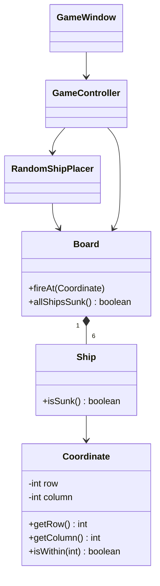
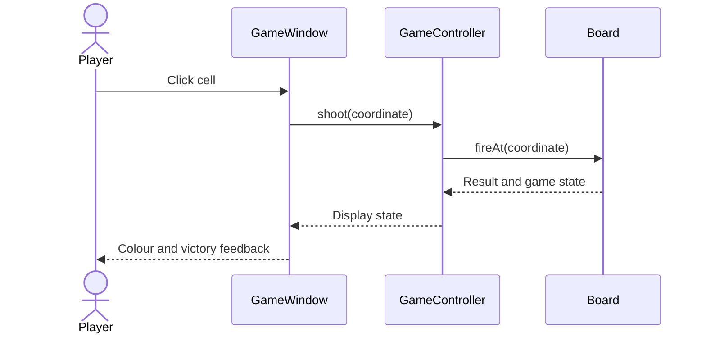
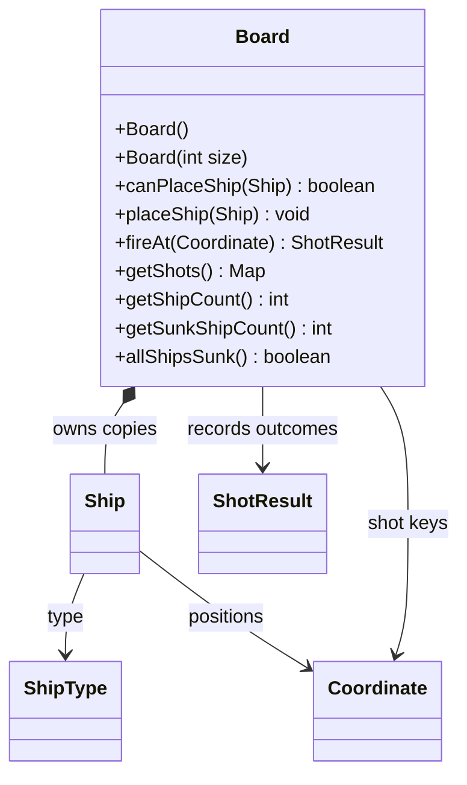
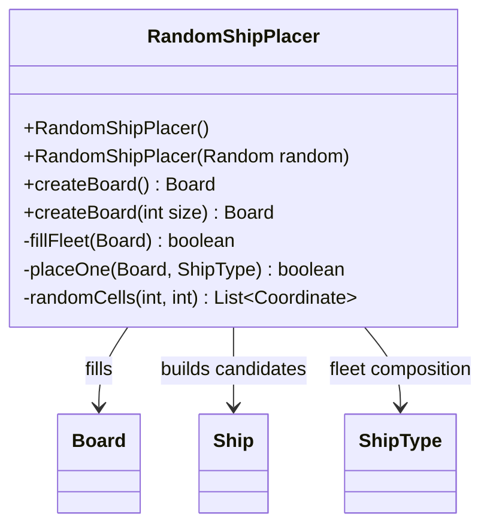

# Proposed UML — not the final implementation

## Class model

Only Coordinate exists. Other signatures remain proposals. Ship inheritance/factory decisions require a useful behavioural reason; different lengths alone do not justify a subclass hierarchy.

## Shot sequence

## Use cases

Actor: human player. Use cases: start game; select target; inspect hit/miss feedback; see victory; restart. Random placement occurs as part of starting a game. This list is a draft inventory: draw the formal UML use-case diagram for the planning report before further implementation.

## Implemented model checkpoint — 15 November 2026

Earlier diagrams remain proposed architecture.

## Implemented service checkpoint — 18 November 2026

The service depends on the model; the model knows nothing about the service. The
controller and the Swing interface are still proposals, so MVC integration remains
pending.
